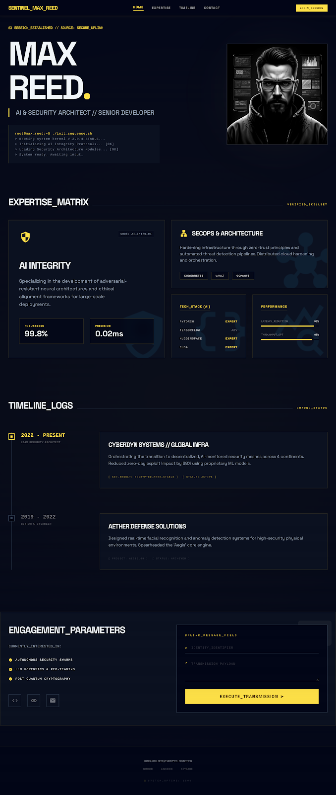

# Martin Begleiter // Professional Sentinel Portfolio

A high-performance personal portfolio built with **Svelte 5** and **Tailwind CSS v4**, featuring a "Professional Sentinel" aesthetic—a balanced technical design inspired by command-line interfaces and security operations centers.



## 🚀 Features

- **Professional Sentinel Aesthetic**: A toned-down technical theme using tonal stepping instead of hard borders, with a focus on "Lemon Glow" yellow accents.
- **Svelte 5 (Runes)**: Leveraging the latest reactivity model for efficient and clean code.
- **Tailwind CSS v4**: Utilizing the cutting-edge utility-first CSS framework with native cascade layer support and improved performance.
- **Bento-style Expertise Grid**: A responsive grid showcasing core competencies with interactive hover effects and glassmorphism.
- **Terminal UI Elements**: Integrated command-line simulations and monospace typography for technical credibility.
- **Markdown Blog**: Content-driven blog system powered by `mdsvex`.
- **Responsive & Accessible**: Fully optimized for all device sizes and WCAG 2.1 AA compliant.
- **Static Site Generation**: Built with SvelteKit's static adapter for lightning-fast delivery via GitHub Pages.

## 🛠️ Tech Stack

- **Framework**: [SvelteKit](https://kit.svelte.dev/) (Svelte 5)
- **Styling**: [Tailwind CSS v4](https://tailwindcss.com/)
- **Content**: [mdsvex](https://mdsvex.pngwn.io/) (Markdown for Blog)
- **Deployment**: [GitHub Pages](https://pages.github.com/) (Static)
- **Icons/Fonts**: Space Grotesk, custom SVGs

## 📁 Project Structure

```text
src/
├── lib/
│   ├── components/       # Atomic design components (hero, expertise, timeline, etc.)
│   ├── content/          # JSON data files and Markdown blog posts
│   ├── styles/           # Global styles and Tailwind directives
│   └── types/            # TypeScript interfaces
├── routes/               # SvelteKit pages and layouts
└── static/               # Assets (images, robots.txt, etc.)
```

## 💻 Development

### Prerequisites

- Node.js (Latest LTS recommended)
- npm

### Setup

1. Clone the repository:
   ```bash
   git clone https://github.com/martinbegleiter/personal-page.git
   ```

2. Install dependencies:
   ```bash
   npm install
   ```

3. Start the development server:
   ```bash
   npm run dev
   ```

### Building

To create a production-ready static build:

```bash
npm run build
```

The output will be in the `build/` directory.

### Code Quality

Run linting and type checks:

```bash
npm run check
```

## 📄 Content Management

- **Timeline/Expertise**: Edit the JSON files in `src/lib/content/data/`.
- **Blog Posts**: Add new `.md` files to `src/lib/content/posts/`.

### Blog Post Structure
Blog posts are markdown files put in `./src/lib/content/posts`.
They contains regular markdown and also a header section with a `title`, `date`, `description` and `tags`. Here is an example:
```markdown
---
title: "Sentinel_Initialization: System_Architect_Log"
date: "2026-04-20"
description: "Initializing the portfolio systems and establishing secure communication channels."
tags: ["Architecture", "AI", "Security"]
---
```

## 🌐 Deployment

This repository is used for staging. The site is copied to the separate
`martinbegleiter.github.io` repository, which GitHub Pages serves as a **user site**
at the domain root (`https://martinbegleiter.github.io/`).

Because production is served from the root — not from a `/personal-page/` subpath —
`kit.paths.base` is intentionally left empty, and root-absolute URLs such as
`/images/...` and `/en/...` are correct. Do not add a `/personal-page` base path.

The `adapter-static` configuration ensures that the entire site is pre-rendered at build time.

## ⚖️ License

MIT © [Martin Begleiter](https://github.com/martinbegleiter)
